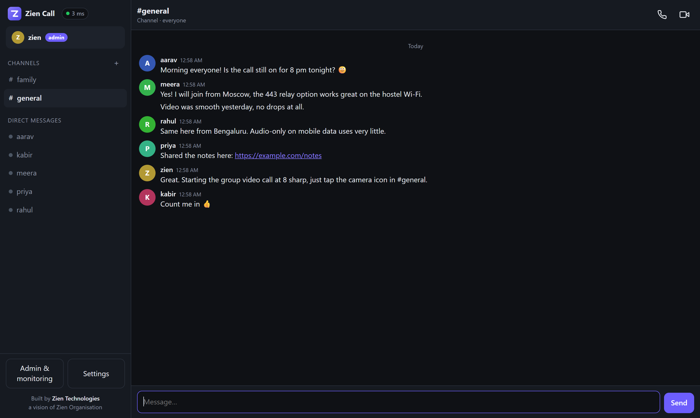
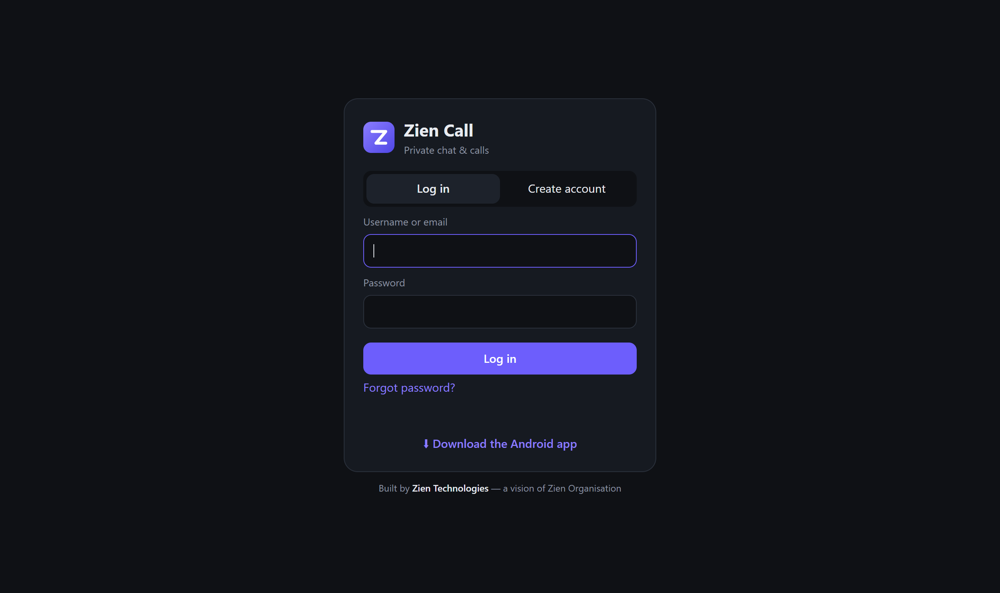
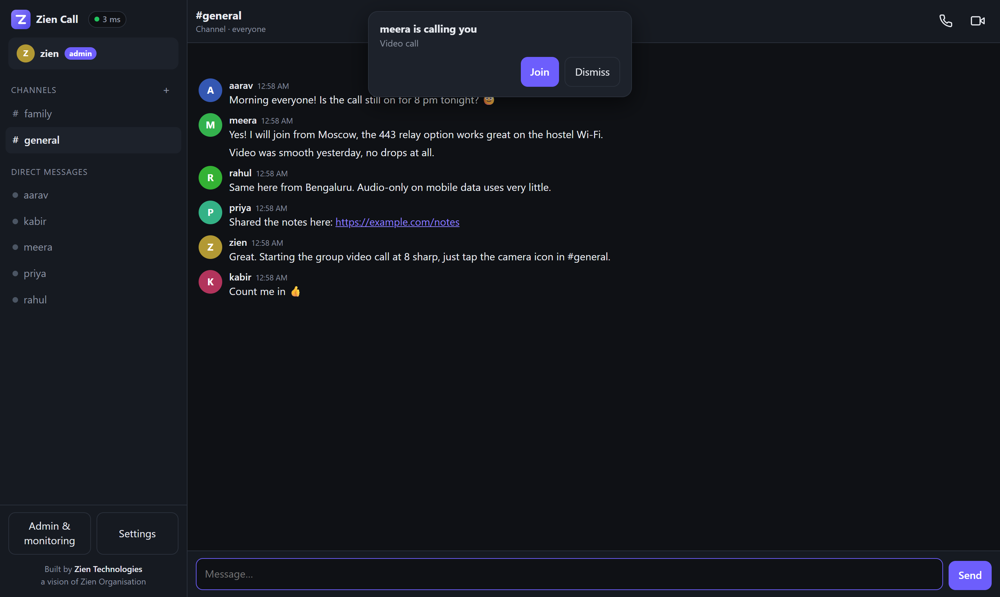
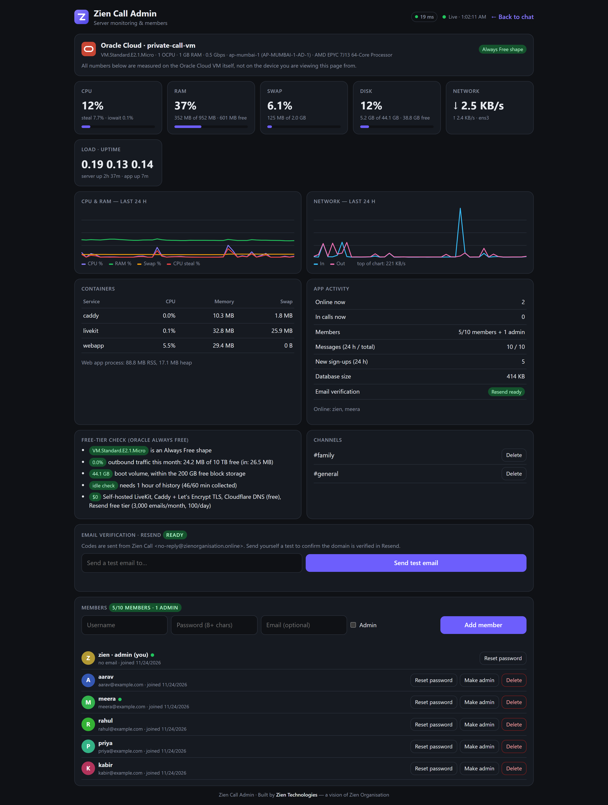
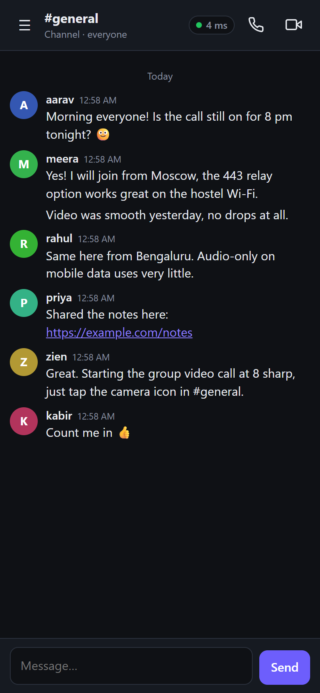
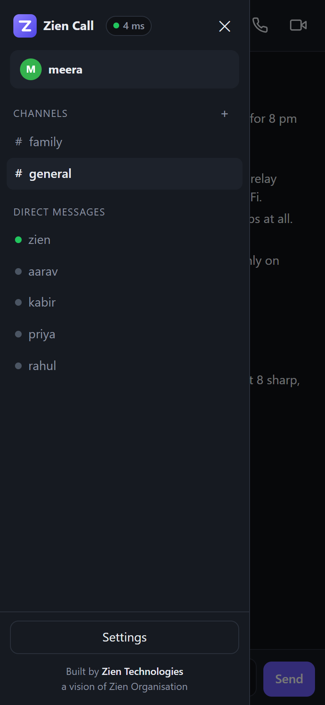
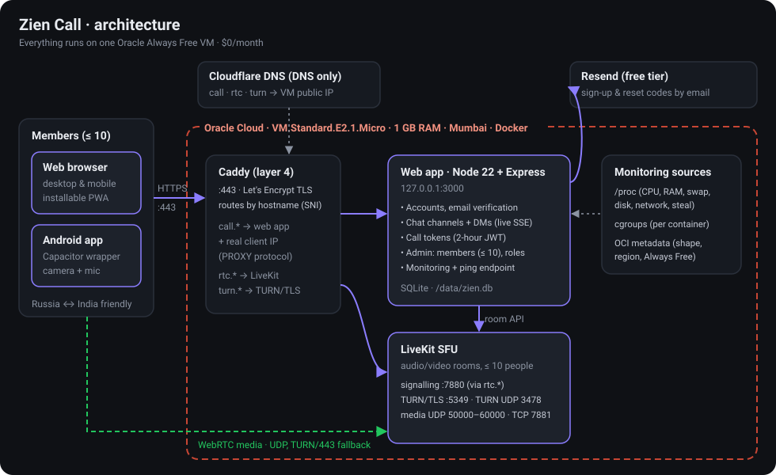

<p align="center">
  
</p>

<h1 align="center">Zien Call</h1>

<p align="center">
  Private chat, voice and video calls for a small group: no phone numbers, no paid services.<br>
  <b>Built by Zien Technologies</b>, a vision of Zien Organisation.
</p>

<p align="center">
  
  
  
  
</p>

<p align="center">
  
</p>

Zien Call is a lightweight, self-hosted alternative to WhatsApp-style group calling, built for a group of up to 10 people.
It is tuned for unreliable international links (Russia ↔ India): when UDP is blocked, media falls back to TURN over port 443.
The whole stack fits in the 1 GB RAM of an Oracle Cloud Always Free VM.

**Live:** https://call.zienorganisation.online · **Android app:** see [Releases](../../releases)

---

## Features

| | |
|---|---|
| 💬 **Chat** | Channels (`#general`, `#family`, …) and private 1-to-1 messages, delivered instantly over Server-Sent Events, with unread badges, online dots and clickable links |
| 📞 **Calls** | Audio or video calls in any channel or private chat, up to 10 people. Incoming-call popup with ring, mute, camera on/off, front/back camera switch |
| 🛡️ **Strict networks** | Optional *Force port-443 relay* (TURN over TLS) for networks that block WebRTC |
| ✉️ **Accounts** | Sign-up with a 6-digit email code (via Resend), forgot-password by email, change password in Settings |
| 👥 **Member limit** | Hard cap of **10 members** (admins don't count). Admins can add, delete, reset passwords and grant admin |
| 📊 **Admin dashboard** | Live CPU, RAM, swap, disk, network and load, per-container stats, 24-hour charts and Oracle free-tier checks, all measured on the Oracle VM itself |
| 📶 **Ping badge** | Round-trip time to the server shown next to the logo, in the mobile top bar and during calls |
| 📱 **Android app** | Capacitor wrapper with camera/mic permissions; the website is also an installable PWA |
| 🔒 **Security** | scrypt-hashed passwords, HttpOnly session cookies, JSON-only writes (CSRF guard), per-IP and per-account rate limits, real client IP via PROXY protocol, app reachable only through Caddy |

## Screenshots

<table>
  <tr>
    <td width="50%"><br><sub>Login / sign-up with email verification</sub></td>
    <td width="50%"><br><sub>Incoming call popup</sub></td>
  </tr>
  <tr>
    <td colspan="2"><br><sub>Admin dashboard: real numbers from the Oracle VM (private-call-vm, VM.Standard.E2.1.Micro)</sub></td>
  </tr>
</table>

<p align="center">
  
  &nbsp;&nbsp;
  
</p>

## Architecture

<p align="center">
  
</p>

| Component | Role |
|---|---|
| **Caddy (layer 4)** `livekit/caddyl4` | Terminates TLS on `:443` with Let's Encrypt and routes by hostname: `call.*` → web app (with PROXY protocol for the real client IP), `rtc.*` → LiveKit signalling, `turn.*` → TURN/TLS |
| **LiveKit SFU** `livekit/livekit-server` | WebRTC rooms (max 10), built-in TURN (TLS 5349 / UDP 3478), media on UDP 50000–60000 and TCP 7881 |
| **Web app** (`app/`) | Node 22 + Express + built-in `node:sqlite`. Accounts, chat, call tokens (2-hour JWT), admin and monitoring. About 30 MB of RAM |
| **Resend** | Sends verification and reset codes from `no-reply@zienorganisation.online` (free tier: 3,000/month) |
| **Cloudflare DNS** | `call`, `rtc`, `turn` A records, *DNS only* (grey cloud) |

Monitoring reads `/proc` (host CPU/RAM/disk/network/steal), cgroup v2 files (per-container CPU and memory) and the Oracle instance metadata service (shape, region, Always Free check). No agents and no API keys needed.

## Repository layout

```
app/                  Web app (Docker image "webapp")
  server.js           API, auth, chat (SSE), calls, admin, PROXY-protocol listener
  metrics.js          Host + container monitoring (/proc, cgroups), 24 h history
  admin-cli.js        Create/reset an admin account (password read from stdin)
  public/             index.html, app.js, app.css (chat UI) · admin.html, admin.js (dashboard)
deploy/               docker-compose.yml, caddy.yaml, livekit.yaml.example, .env.example, set-resend-key.sh
mobile/               Capacitor 6 Android project (loads the live site)
tests/                e2e.mjs (90 end-to-end API checks) · resend-mock.mjs (email flow against a fake Resend)
docs/                 Architecture diagram and screenshots
```

## Deploy (Oracle Cloud Always Free)

1. **VM:** Ubuntu 24.04 on `VM.Standard.E2.1.Micro` (add 2 GB swap). Open TCP 80, 443, 7881 and UDP 3478, 50000–60000 in the OCI security list and in `iptables`.
2. **DNS:** point `call.`, `rtc.` and `turn.` A records at the VM's public IP (Cloudflare *DNS only*).
3. **Files:** copy this repo to `/opt/private-call`, then:
   ```bash
   cd /opt/private-call
   cp deploy/docker-compose.yml deploy/caddy.yaml .
   cp deploy/livekit.yaml.example livekit.yaml      # put your LiveKit key + secret under "keys"
   cp deploy/.env.example .env && chmod 600 .env     # same key + secret here
   mkdir -p data && sudo docker compose up -d --build
   ```
4. **Admin account** (the password is read from stdin, so it never appears in shell history):
   ```bash
   read -rsp 'Admin password: ' P; printf '%s' "$P" | sudo docker compose exec -T webapp node admin-cli.js zien; unset P
   ```
5. **Email verification:** verify your domain in [Resend](https://resend.com), create a *sending-only* API key, then run `sudo ./deploy/set-resend-key.sh`.
6. Open `https://call.<your-domain>/admin`, press **Send test email**, and add members.

Updating: copy the new `app/` folder and run `sudo docker compose up -d --build webapp`.

## Android app

```bash
cd mobile
npm install
npx cap sync android
cd android && ./gradlew assembleDebug     # JDK 17 + Android SDK 34
```
The APK (`app/build/outputs/apk/debug/app-debug.apk`) opens `https://call.zienorganisation.online` and asks for camera/mic permissions when a call starts. If you place it at `app/public/zien-call.apk` on the server, the login page shows a download link.

## Tests

```bash
# email flow against a local fake Resend (no real emails)
node tests/resend-mock.mjs

# full end-to-end checks against a running server (needs an admin session token)
BASE=https://call.zienorganisation.online ADMIN_SID=<token> EXPECT_ORACLE=1 LIVEKIT_VALIDATE=1 node tests/e2e.mjs
```
`e2e.mjs` creates throwaway `zt…` accounts and deletes them afterwards. It covers access control, the 10-member limit, chat and live delivery, private-chat privacy, call tokens (validated by LiveKit), password changes, admin roles and deletion.

## Free-tier budget

| Resource | Free allowance | Zien Call usage |
|---|---|---|
| Oracle VM | E2.1.Micro, 1 GB RAM | ~350 MB used (caddy 10 MB, livekit 33 MB, webapp 30 MB) |
| Oracle egress | 10 TB / month | tracked on the admin page |
| Block storage | 200 GB | 44 GB boot volume |
| Resend | 3,000 emails / month | only sign-up and reset codes |
| Cloudflare DNS, Let's Encrypt | free | |

> Oracle may reclaim Always Free VMs that stay idle (low CPU **and** network for 7 days). The admin page warns when CPU p95 is low; upgrading the account to Pay-As-You-Go keeps Always Free resources at $0 and avoids reclamation.

---

<p align="center"><sub>Zien Call · Built by <b>Zien Technologies</b>, a vision of Zien Organisation</sub></p>
